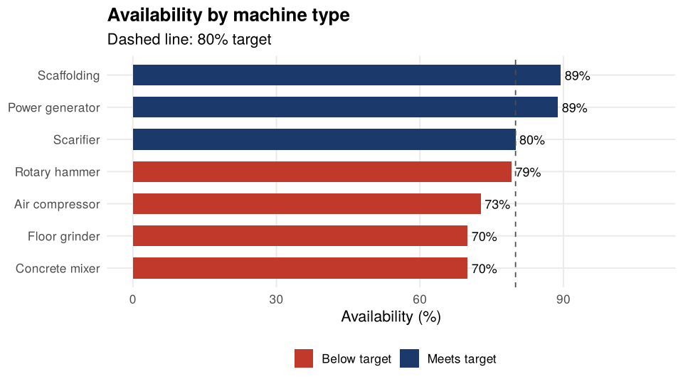

# Logistics and Operations KPIs for a Construction Company

**R** analysis of a construction company's operational capacity: machinery availability, weekly workforce behavior and material delivery times to job sites.

📄 **[See the full analysis with charts →](analysis.md)**

> The data is **simulated** and represents a fictitious company. The project is based on a technical report I prepared in a real work setting; the original data was replaced with random data that keeps the same structure so it could be published.

## Questions it answers

1. Which machine types fall below the availability target?
2. Does equipment age increase the probability of breakdown?
3. How does the active workforce change throughout the year?
4. How fast do materials reach job sites, and what does the contingency warehouse add?

## Key findings

- Overall machinery availability of **78.6%**, with four equipment types below the 80% target.
- Each year of age multiplies the odds of a machine being under repair by **1.35** (logistic regression, p < 0.01).
- The workforce averages **46 employees per week**, peaking mid-year.
- **72.6%** of requisitions are delivered in 2 days or less; the contingency warehouse delivers faster than the main one.



## Tools

R · ggplot2 · knitr · R Markdown · logistic regression (`glm`)

## Structure

```
├── analysis.Rmd         # Analysis code
├── analysis.md          # Rendered output with tables and charts (viewable on GitHub)
├── R/generate_data.R    # Script that generates the simulated data (seed 2026)
├── data/                # CSV data
└── figures/             # Generated charts
```

## How to reproduce

```r
source("R/generate_data.R")          # creates the CSV files in data/
rmarkdown::render("analysis.Rmd")    # creates analysis.md and the charts
```

## Author

**Karen Regina Martínez Martínez** · [LinkedIn](https://www.linkedin.com/in/karen-regina-martinez-martinez-2146811a8)
