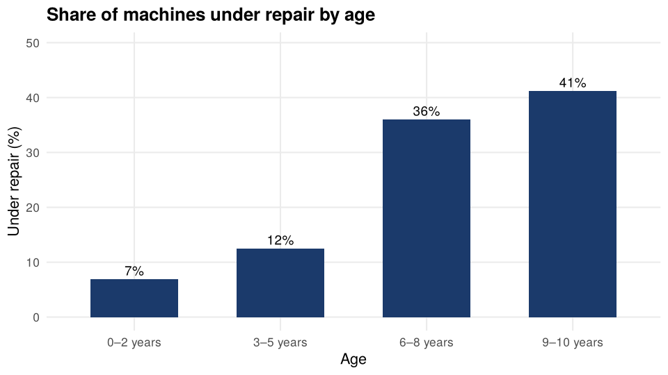
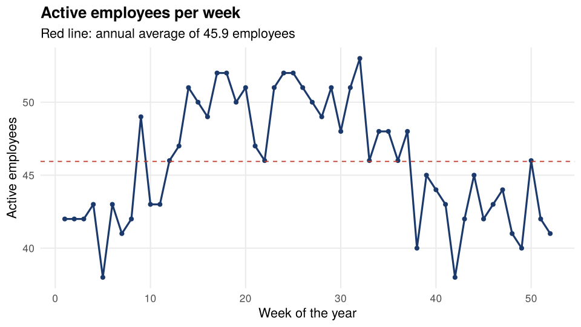
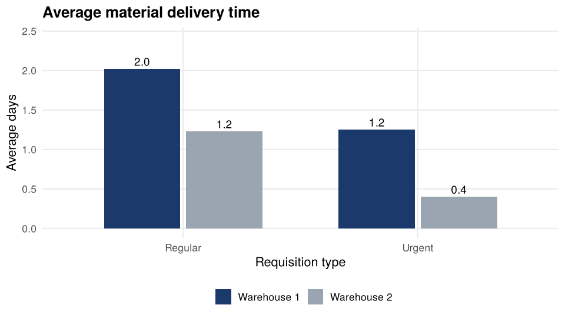

Logistics and Operations KPIs for a Construction Company
================
Karen Regina Martínez Martínez

- [1. Objective](#1-objective)
- [2. Data](#2-data)
- [3. Machinery](#3-machinery)
  - [3.1 Overall indicators](#31-overall-indicators)
  - [3.2 Availability by machine type](#32-availability-by-machine-type)
  - [3.3 Does age drive breakdowns?](#33-does-age-drive-breakdowns)
- [4. Staff](#4-staff)
- [5. Material supply](#5-material-supply)
- [6. Conclusions](#6-conclusions)

> **Note:** all data in this project is **simulated** with the script
> [`R/generate_data.R`](R/generate_data.R) and represents a fictitious
> construction company. It does not correspond to any real company.

## 1. Objective

Measure the operational capacity of a construction company on three
fronts:

1.  **Machinery:** how available is the equipment, and what takes it out
    of service?
2.  **Staff:** how does the active workforce behave throughout the year?
3.  **Material supply:** how many days do requisitions take to reach the
    job site, and how useful is the contingency warehouse?

## 2. Data

``` r
machinery    <- read.csv("data/machinery.csv")
staff        <- read.csv("data/weekly_staff.csv")
requisitions <- read.csv("data/requisitions.csv")
```

| File               | Records | Content                                                             |
|--------------------|---------|---------------------------------------------------------------------|
| `machinery.csv`    | 103     | Type, warehouse, age, status and days under repair for each machine |
| `weekly_staff.csv` | 52      | Active employees and active job sites per week                      |
| `requisitions.csv` | 420     | Material requisitions by site, warehouse, urgency and delivery days |

## 3. Machinery

### 3.1 Overall indicators

``` r
total     <- nrow(machinery)
available <- sum(machinery$status == "Available")
in_repair <- sum(machinery$status == "Under repair")

kpi <- data.frame(
  Indicator = c("Total machines", "Available", "Under repair",
                "Availability rate (%)",
                "Median days under repair"),
  Value = c(total, available, in_repair,
            round(available / total * 100, 1),
            median(machinery$days_under_repair, na.rm = TRUE))
)
kable(kpi)
```

| Indicator                | Value |
|:-------------------------|------:|
| Total machines           | 103.0 |
| Available                |  81.0 |
| Under repair             |  22.0 |
| Availability rate (%)    |  78.6 |
| Median days under repair |  13.5 |

### 3.2 Availability by machine type

``` r
rate_type <- aggregate(status ~ type, data = machinery,
                       FUN = function(x) mean(x == "Available") * 100)
names(rate_type)[2] <- "availability"
rate_type$type <- reorder(rate_type$type, rate_type$availability)
target <- 80

ggplot(rate_type, aes(x = type, y = availability,
                      fill = availability >= target)) +
  geom_col(width = 0.65) +
  geom_hline(yintercept = target, linetype = "dashed", color = "grey30") +
  geom_text(aes(label = sprintf("%.0f%%", availability)),
            hjust = -0.15, size = 3.8) +
  scale_fill_manual(values = c(`TRUE` = navy, `FALSE` = red),
                    labels = c(`TRUE` = "Meets target", `FALSE` = "Below target"),
                    name = NULL) +
  coord_flip(ylim = c(0, 108)) +
  labs(title = "Availability by machine type",
       subtitle = paste0("Dashed line: ", target, "% target"),
       x = NULL, y = "Availability (%)") +
  theme(legend.position = "bottom")
```

<!-- -->

### 3.3 Does age drive breakdowns?

``` r
machinery$age_group <- cut(machinery$age_years,
                           breaks = c(-1, 2, 5, 8, 10),
                           labels = c("0–2 years", "3–5 years",
                                      "6–8 years", "9–10 years"))
rate_age <- aggregate(status ~ age_group, data = machinery,
                      FUN = function(x) mean(x == "Under repair") * 100)
names(rate_age)[2] <- "under_repair"

ggplot(rate_age, aes(x = age_group, y = under_repair)) +
  geom_col(fill = navy, width = 0.6) +
  geom_text(aes(label = sprintf("%.0f%%", under_repair)),
            vjust = -0.4, size = 4) +
  labs(title = "Share of machines under repair by age",
       x = "Age", y = "Under repair (%)") +
  ylim(0, max(rate_age$under_repair) * 1.2)
```

<!-- -->

``` r
# Logistic regression: probability of being under repair vs. age
model      <- glm(I(status == "Under repair") ~ age_years,
                  data = machinery, family = binomial)
odds_ratio <- exp(coef(model)["age_years"])
p_value    <- summary(model)$coefficients["age_years", 4]
```

Using a logistic regression, each additional year of age multiplies the
odds of a machine being under repair by **1.35** (p = 0.0016).

## 4. Staff

``` r
average <- mean(staff$active_employees)

ggplot(staff, aes(x = week, y = active_employees)) +
  geom_line(color = navy, linewidth = 0.9) +
  geom_point(color = navy, size = 1.6) +
  geom_hline(yintercept = average, linetype = "dashed", color = red) +
  labs(title = "Active employees per week",
       subtitle = sprintf("Red line: annual average of %.1f employees", average),
       x = "Week of the year", y = "Active employees")
```

<!-- -->

``` r
staff$employees_per_site <- staff$active_employees / staff$active_sites
```

- Weekly average: **45.9 employees** (minimum 38, maximum 53).
- On average there are **9.4 employees per active job site**.

## 5. Material supply

``` r
requisitions$type <- ifelse(requisitions$urgent, "Urgent", "Regular")
delivery <- aggregate(delivery_days ~ warehouse + type, data = requisitions, FUN = mean)

ggplot(delivery, aes(x = type, y = delivery_days, fill = warehouse)) +
  geom_col(position = position_dodge(width = 0.7), width = 0.65) +
  geom_text(aes(label = sprintf("%.1f", delivery_days)),
            position = position_dodge(width = 0.7), vjust = -0.4, size = 4) +
  scale_fill_manual(values = c(navy, grey), name = NULL) +
  labs(title = "Average material delivery time",
       x = "Requisition type", y = "Average days") +
  ylim(0, max(delivery$delivery_days) * 1.2) +
  theme(legend.position = "bottom")
```

<!-- -->

``` r
on_time  <- mean(requisitions$delivery_days <= 2) * 100
pct_wh2  <- mean(requisitions$warehouse == "Warehouse 2") * 100
```

- **72.6%** of requisitions are delivered in 2 days or less.
- The contingency warehouse (Warehouse 2) handles **21.2%** of
  requisitions and delivers faster than the main warehouse.

## 6. Conclusions

1.  Overall machinery availability is **78.6%**, but it is uneven: the
    types shown in red are below target and are the first candidates for
    preventive maintenance.
2.  Equipment age clearly increases the probability of breakdown, which
    helps prioritize machinery replacement.
3.  The workforce follows a yearly cycle with more staff mid-year;
    knowing this allows hiring and payroll to be planned ahead.
4.  The contingency warehouse shortens delivery times; it is worth
    evaluating whether to expand its use for high-demand job sites.
